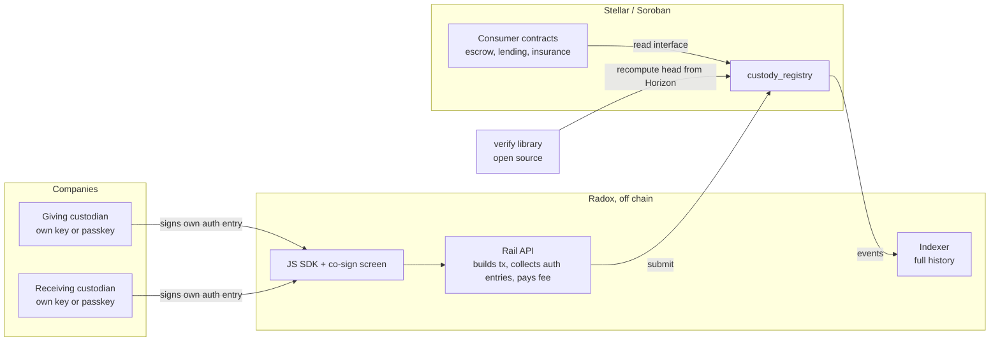
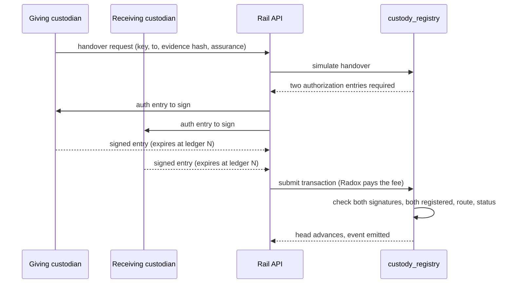

# Radox Rail — technical architecture

Co-signed cargo custody between companies, readable by any Soroban contract.
Prepared for the Stellar Community Fund #46 (Open Track). v0.1 is deployed; v2 is the scope of the award.

## 1. Purpose and trust model

Radox Rail records who physically holds a shipment, handover by handover, on Stellar, and lets any Soroban contract
read it. The registry moves no money and no token.

- What the chain proves: which registered organizations signed each step, in order.
- What it does not prove: that the goods moved. Two colluding custodians can sign a false step. Each step carries an
  assurance level and an evidence hash, and signers are registered organizations, so a false step is attributable to
  named companies.

## 2. Components and trust boundaries



On chain (Apache-2.0, this repository):
- `custody_registry` v0.1 on mainnet: `CDV7YI7KYTDH4LPOLVUVRTFERJKYOWBBT6KS56ZX3V7EOGDBWS7LD4UP`.
  Functions: open, handover, attest, deliver, get, head, freeze, unfreeze, pause, resume, emergency_pause, set_pauser,
  is_paused, add_source, remove_source, version. v0.1 has no upgrade function: v2 is a new contract, and v0.1 shipments
  stay on v0.1.
- v2 adds: organization registry with KYB attestation; lots (split, consolidate); typed exceptions (damage, partial
  delivery, dispute); a standard read interface for other contracts.
- Demo consumer (v2): an escrow contract that releases USDC only when the registry reports Delivered.

Off chain: Rail API and indexer (Radox) build each transaction, collect the custodians' authorization entries, pay the
fee and submit; the indexer keeps full history beyond the RPC event window. JS SDK and a reference co-sign screen.
Verify library (open source). Stellar RPC (simulate, submit) and Horizon (history) are the only chain endpoints.

Trust boundaries: the custodian's device and key; the Rail API (cannot sign for a custodian, can refuse to relay); the
Stellar network; third parties that read the registry.

## 3. Data model

```
Shipment     { key (32 bytes), current_custodian, route, seq, head (32 bytes),
               status: Open | Delivered | Frozen, parent (split/consolidated lot), open exceptions }
Organization { address, organization id, unit, KYB status, attester }
```

Head rule (SHA-256):
- open: `0x01 || key || docs_root`
- handover: `0x02 || head || XDR(from) || XDR(to) || evidence_hash || u32be(seq) || u32be(assurance)`
- attest: `0x03 || head || XDR(source) || u32be(kind) || event_hash || u32be(seq)`

`XDR` is the Soroban Address value in XDR. The same test vector runs in the contract tests and in the off-chain
verifier. v2 adds tagged steps for split, consolidate and exception, defined in the Custody Standard v1.0.

Read interface (v2), read-only, no authorization: `custodian_of(key)`, `is_delivered(key)`, `last_step(key)`,
`organization_of(address)`.

## 4. Flow of one handover



Each custodian signs only its own entry on its own device (ed25519 for a G-address, a WebAuthn secp256r1 assertion for
a passkey smart account). Each entry covers one invocation, with a nonce and an expiration ledger a few minutes ahead.
If one entry expires before the other party signs, the API discards it and both sign a fresh request. The chain records
the confirmation time; the device timestamp is inside the evidence hash.

## 5. Keys

- Admin (freeze, pause, allow-list sources and KYB attesters): hardware wallet.
- Operator (opens shipments): Radox service key. If compromised, an attacker can open shipments with a chosen route,
  but cannot sign handovers.
- Fee payer: Radox account. Compromise costs XLM, not custody.
- Custodian keys: held by each company (passkey on its device, or its own key). A lost key stops that shipment; the
  admin can freeze it.
- Event sources and KYB attesters: allow-listed by the admin; they cannot change custody.

## 6. Failure modes

| Failure | Handling |
|---|---|
| RPC unavailable | Submit through a second RPC; Horizon for reads. |
| Indexer behind | The verify library rebuilds history from Horizon. |
| Archived entries | Shipment time-to-live is extended on each use; an invocation restores archived entries after simulation. |
| Expired signature | New request, both parties sign again. |
| Lost or refusing custodian key | Admin freeze. |
| Wrong route at open | Not editable: freeze and reopen under a new key. |
| Contract bug | Pause stops writes; a fix is a new contract. |

## 7. Security

Only addresses, hashes and status go on chain; commercial documents stay off chain, with their hashes in the record.
The STRIDE threat model and the on-chain monitoring plan are delivered in Tranche 2; the v2 contracts go through the
SCF Audit Bank before mainnet. v0.1 has unit and property tests and has not been audited.

## 8. Cost

On mainnet each v0.1 handover was charged 0.0015 XLM (Horizon). The nine-transaction test shipment cost 13.58 XLM in
total, of which 13.40 XLM was the one-time upload of the contract code.

## 9. Check it yourself

- Mainnet: the registry [`CDV7YI7K…WS7LD4UP`](https://stellar.expert/explorer/public/contract/CDV7YI7KYTDH4LPOLVUVRTFERJKYOWBBT6KS56ZX3V7EOGDBWS7LD4UP)
  and the test shipment `5dc2e39a…25656b2d` (status Delivered, seq 4), with its transactions on Stellar Expert.
- Head rule: in [`radox-labs/miami-rio-rail`](https://github.com/radox-labs/miami-rio-rail),
  `node scripts/verify-head.mjs --selftest` recomputes the fixed test vector that the contract's unit test also uses.
- Full history: the same script recomputes a testnet demo shipment's head from Horizon and prints MATCH against
  `head(key)`; [rio-miami-rail.vercel.app](https://rio-miami-rail.vercel.app) does the same in the browser.
  Mainnet support in the script is a Tranche 2 deliverable (verify library).

## 10. How the award is measured on chain

Each shipment adds an open, one co-signed handover per change of custody and a delivery; each company adds an
organization entry and its own signing account; each consumer contract reads the registry before it pays. All of it
is counted from public chain data. The Tranche 3 metric: at least 12 co-signed handovers, across at least 3
shipments and at least 4 outside organizations, on the mainnet v2 registry, where both signers are registered
organizations outside the Radox team.
